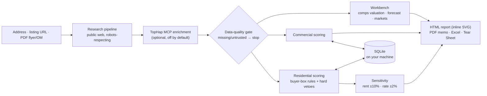

# DealDesk

A self-hosted real-estate underwriting desk for individual investors and small investment teams: it gathers
the public record for a property, scores the deal against written rules, and attaches a source to every figure.

| | |
|---|---|
| Status | Active — v1.0.0 (`pyproject.toml`); v2 deal workbench listed as 2.0.0, unreleased, in the [CHANGELOG](CHANGELOG.md). CI runs pytest, ruff, mypy, a Postgres suite, frontend typecheck / lint / unit tests, Playwright E2E with axe, CodeQL, dependency review, pip-audit / npm audit, gitleaks and OpenSSF Scorecard |
| Deployment | Self-hosted: Python 3.10+, SQLite by default (Postgres supported); production instance on Vercel |
| Live instance | [vertciti-dealdesk.vercel.app](https://vertciti-dealdesk.vercel.app/app/) — the founder's production workbench; sign-in is for the operator and invited friends only, with no public sign-up. |
| Interfaces | Web UI (v2 workbench at `/app/`) · HTTP API (`/api`, `/api/v2`, bearer tokens) |
| Licence | MIT ([LICENSE](LICENSE)) |
| Languages | English · [简体中文](README.zh.md) |
| Contact | Vulnerabilities: [SECURITY.md](SECURITY.md) · Product: [vertciti.com](https://vertciti.com) |


## Overview

An investor screening a deal usually starts from a broker flyer and spends hours moving figures between
spreadsheets and data sites, ending with numbers that cannot be traced back to anything. DealDesk takes a bare
address, a listing URL or a PDF flyer / offering memorandum, gathers public listings, public records, taxes,
schools and neighbourhood data, and stops at a data-quality gate if key fields are missing. Deals that pass are
scored by residential or commercial rule sets, with sensitivity bands and a full cash-to-close figure. Every
field carries its source, fetch time and confidence; what cannot be fetched is shown as missing, never filled in.

It is a screening aid, not investment advice. Before any signing, closing or tax filing, a licensed local
real-estate attorney, a CPA and a title company review the deal.

## Demo — a real run


Recorded on 2026-10-20 against a local instance of this code. The subject is a real Astoria, NY duplex whose
public record was gathered the same day by the production intake (TopHap via MCP, 28 fields with sources). The
walkthrough values it from its 10 comparable sales, runs the 5-year scenarios, then opens a built-in demo
project's stored score and the HTML report it generates.

- **Intake** — the subject property with public-record figures.
  
- **Valuation** — ten comparable sales reconcile to an estimate of $1,211,530. Rent is not in the public record,
  so the income approach reports "manual needed" instead of a guess.
  
- **Forecast** — five-year scenarios on top of the estimate; the API labels a scenario as a hypothesis.
  
- **Score and report** — a scored deal dimension by dimension, and the HTML report (inline SVG charts) generated
  in the same run.
  
- **v1 web UI** — the mode picker (residential plain-language mode, commercial pro mode), and the same duplex as a
  one-page decision sheet at a $1,150,000 ask: verdict PASS, deal score 43/100, confidence 64.2. Because rent data
  is missing, the sheet states that DSCR cannot be underwritten and downgrades itself.
  

UI captures, 2026-10-20: browser screenshots of a local instance of this repo's code (seed-DB copy), Chromium
via Playwright. Capture basis is registered in [assets/ASSETS.md](assets/ASSETS.md). These show the v1
interface; the [CHANGELOG](CHANGELOG.md) records that v2 retires the v1 single page and redirects it to `/app/`.

## Capabilities

| Area | What it does |
|---|---|
| **Intake** | Address, listing URL or PDF flyer / OM. Public listings, public records, taxes, schools and neighbourhood data; each field carries source, fetch time and confidence grade. Seller-supplied figures stay labelled *seller's figures — unverified*. |
| **Data-quality gate** | Missing key fields or an untrusted source stop the deal with a "needs manual input" list before any calculation. |
| **Scoring** | Residential and commercial tracks score independently (A / B / C / reject). Hard vetoes are surfaced first: floating rates, a balloon inside five years, no exit plan, pro-forma rent without comps. Each point traces to a written rule in the code. |
| **Cash to close** | Down payment, closing costs, first-year capex and reserves summed for every deal. |
| **Sensitivity** | Rent ±10% and rate ±2% bands showing cash flow, cash-on-cash, DSCR and entry cap. |
| **Workbench** | Comps valuation (distance-weighted, reconciled with the income approach), market research on embedded public FHFA index data, a six-dimension market report; results can be sent into the scoring engine. |
| **Reports** | Interactive HTML report with inline SVG charts, PDF underwriting memo, Excel model (rolling out in batches), one-page Tear Sheet PDF — same numbers in every format. |
| **Compare** | Up to three projects side by side: CoC, DSCR, payback period. |
| **v2 deal workbench** (`/app/`) | Pipeline (kanban / table) and a deal page with verdict card, verification progress and tabs for rent roll, T12, model, red team, market, files and evidence, committee, holding and log. Every number has a "passport" (source, page, extraction method, confidence, reviewer, freshness); conflicting sources must be resolved with a written reason. Max bid worked backwards from IRR / DSCR / cash-on-cash targets, naming the binding constraint. Seven-stage lifecycle with gates, committee votes and pack, a decision log that freezes the numbers, post-hoc attribution. Roles (chairman / analyst / viewer), audit log, keyboard-first, dark mode, mobile read-only. v1 calculations are unchanged and replayed against recorded outputs on every test run ([ADR 0001](docs/adr/0001-golden-master.md)). |

## Quick start

```bash
git clone https://github.com/HUIIIM/vertciti-dealdesk.git && cd vertciti-dealdesk
./run.sh        # creates the venv, installs deps, initialises the DB, serves
```

Open http://127.0.0.1:8100 and create a project. `GET /api/health` answers `{"ok": true, "service": "dealdesk"}`.

Manual equivalent:

```bash
python3 -m venv .venv && .venv/bin/pip install -r requirements.txt
.venv/bin/python -c "from app import db; db.init_db()"
.venv/bin/uvicorn app.main:app --host 127.0.0.1 --port 8100
```

Run the tests (delete the dev by-product DB first — a known test-isolation quirk, documented in
[AGENTS.md](AGENTS.md)):

```bash
rm -f dealdesk.db
PYTHONPATH=. .venv/bin/pytest tests/ -q
```

## Architecture



v2 adds `domain / services / api` layers, SQLAlchemy 2 + Alembic (SQLite or Postgres) and a TypeScript + React
frontend with an OpenAPI-generated client. Design decisions are recorded in [docs/adr/](docs/adr/); operations
in the [runbook](docs/RUNBOOK.md) and [docs/PRODUCT-LOGIC.md](docs/PRODUCT-LOGIC.md).

## Security and compliance

- Self-hosted: deal data stays in a database on your own infrastructure. The one optional external paid layer is
  TopHap public-record enrichment, off by default and priced by TopHap.
- v2: roles (chairman / analyst / viewer), bearer tokens stored only as hashes, rate limiting on bad tokens, an
  audit log, security response headers and a strict CSP, JSON logs with request IDs.
- Collection touches public pages only and respects `robots.txt`; when a site blocks the fetch, the pipeline
  stops, logs it and falls back to manual entry.
- Listing-page and PDF figures stay labelled *seller's figures — unverified* until independently checked.
- Report vulnerabilities privately as described in [SECURITY.md](SECURITY.md).

## Status and limitations

DealDesk is vertciti's working showcase, built for one operator and run in production at
[vertciti-dealdesk.vercel.app](https://vertciti-dealdesk.vercel.app/app/). Improvements are logged in
[docs/improvement-backlog.md](docs/improvement-backlog.md).

- **Primary data source in production: TopHap** (public-record aggregation over MCP — valuation reference with
  range, loan and title history, tax assessments, foreclosure signals, comparable sales), verified live on
  2026-10-20. The public-web pipeline and the U.S. Census geocoder act as fallbacks.
- **RentCast: adapter built, not active** until its account is funded — an external blocker.
- The public-web search layer is subject to search-engine anti-bot walls; when blocked, fields degrade to
  "manual needed", visible in the run log.
- Scanned-PDF OCR exists, but complex two-column offering memoranda are flagged for human review rather than
  parsed by guesswork.
- v2 is recorded as unreleased (2.0.0) in the [CHANGELOG](CHANGELOG.md).

## Roadmap (planned, not shipped)

- **One-sentence verdict entry** — a natural-language question orchestrates comps → underwriting → tear sheet
  and returns a cited decision.
- **Buy-box auto-scoring** — written constraints as config; incoming deals scored against them.
- **Deal watchlist** — tracked deals re-valued weekly, with drift alerts.
- **DealDesk MCP server** — pipeline, comps and underwriting results queryable by an AI agent.

Direction: [ROADMAP.md](ROADMAP.md) · [docs/improvement-backlog.md](docs/improvement-backlog.md)

## Documentation · Support · Licence

- [CHANGELOG.md](CHANGELOG.md) · [ROADMAP.md](ROADMAP.md) · [docs/RUNBOOK.md](docs/RUNBOOK.md) ·
  [docs/adr/](docs/adr/) · [docs/PRODUCT-LOGIC.md](docs/PRODUCT-LOGIC.md)
- Contributing: [CONTRIBUTING.md](CONTRIBUTING.md). Tests pin the headline numbers, comments state their
  assumptions, and no figure is fabricated.
- Security: [SECURITY.md](SECURITY.md).
- Licence: MIT — see [LICENSE](LICENSE). Created by
  Jiahui Miao.

---

Built by [vertciti](https://vertciti.com) — https://vertciti.com
