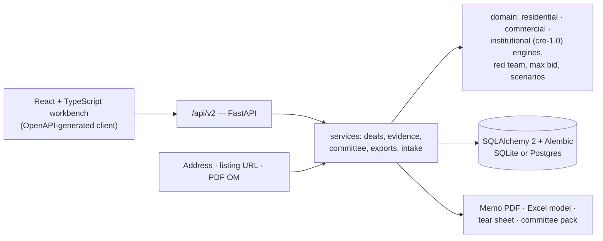

# DealDesk

**Institutional-grade underwriting, with every number accounted for.**

DealDesk takes a deal from a bare address or an offering memorandum to an investment-committee pack in one
system: lease-by-lease cash flows, the full capital stack and GP / LP waterfall, a red team that finds the
assumption that matters, and an audit trail a committee can verify to the cent. Self-hosted, open source (MIT),
built by [vertciti](https://vertciti.com).

| | |
|---|---|
| Status | Production: **v2.0.0** (`/api/v2/health`, checked 2026-10-23). Next release: **2.1.0** — institutional underwriting engine cre-1.0, Google sign-in (invitation only) and the admin console; merged, awaiting deployment ([CHANGELOG](CHANGELOG.md)) |
| Quality gates | CI on every PR: pytest (≥85% coverage, v1 golden master), ruff, mypy strict, Postgres suite, frontend typecheck / lint / unit tests, Playwright E2E with axe, CodeQL, dependency review, pip-audit / npm audit, gitleaks, OpenSSF Scorecard |
| Deployment | Self-hosted: Python 3.10+, SQLite by default, Postgres via `DATABASE_URL`; production instance on Vercel |
| Live instance | [vertciti-dealdesk.vercel.app](https://vertciti-dealdesk.vercel.app/app/) — the founder's production workbench; sign-in is for the operator and invited friends only, with no public sign-up. |
| Interfaces | Web workbench (`/app/`) · HTTP API (`/api/v2`, OpenAPI, bearer tokens) |
| Languages | Product UI and API: English · 简体中文 · README: English · [简体中文](README.zh.md) |
| Licence | MIT ([LICENSE](LICENSE)) |
| Contact | Vulnerabilities: [SECURITY.md](SECURITY.md) · Product: [vertciti.com](https://vertciti.com) |


## Why DealDesk

Most underwriting still lives in a spreadsheet nobody else can audit: figures typed in from a broker flyer, an
assumption buried in a hidden tab, a committee asked to approve numbers it cannot trace. DealDesk is built for
the opposite — a decision you can defend line by line.

| | |
|---|---|
| **Depth of a CRE model** | Lease-by-lease and unit-by-unit monthly cash flow, mezzanine, refinance, construction loans and a GP / LP waterfall with catch-up and clawback — exported as a live-formula Excel model that recalculates to match the engine. |
| **Discipline of an audit** | Every figure carries its source, page, reviewer and freshness. Conflicts must be resolved in writing. Missing data stays missing. |
| **Judgement you can check** | The red team ranks assumptions by how far they move the return; the devil's-advocate memo is assembled by fixed rules, never by AI; every run can be recomputed by ID. |
| **Control of your own stack** | Self-hosted on your infrastructure, SQLite or Postgres, roles and an audit log of every change; deal data stays on your servers, and the one paid data integration is off by default. |

Built for investors, family offices and small investment teams who underwrite their own deals and answer to a
committee — residential rentals through institutional office, multifamily and ground-up development.

## Overview

How DealDesk keeps the underwriting and its evidence in one place:

- **Every number has a passport** — source, page, extraction method, confidence, reviewer and freshness.
  Conflicting sources are logged and must be resolved with a written reason. Missing data stays missing
  ("—"); nothing is filled in.
- **The deal decides what to check first** — the red team measures how far each assumption moves the return,
  and the verification queue ranks open items by that swing.
- **The case against the deal is written by rules, not AI** — the devil's-advocate memo lists kill-criteria hits,
  thin margins, concentration and refinancing risk, each with the number behind it.
- **The committee sees frozen numbers** — packs and decisions carry the run ID and an input hash; anyone can
  recompute a run and confirm it matches to the cent.

It is a screening and underwriting aid, not investment advice. Before any signing, closing or tax filing, a
licensed local real-estate attorney, a CPA and a title company review the deal.

## Underwriting tracks

| Track | For | Engine |
|---|---|---|
| **Residential** | 1–4 unit homes and small rentals | Buyer-box rules with hard vetoes, mortgage, cash-on-cash, DSCR, full cash to close |
| **Commercial** | Small commercial and mixed-use | Rent roll and T12 to NOI, cap rate, DSCR, IRR; sensitivity bands |
| **Institutional** *(2.1.0, awaiting deployment)* | Office / retail / industrial, multifamily, ground-up development | Monthly cash flow lease by lease or unit type by unit type; senior, mezzanine, refinance and construction debt; GP / LP waterfall — see [methodology](docs/INSTITUTIONAL-ENGINE.md) |

### Institutional engine (cre-1.0)

- **Leases** — escalations, free rent, recoveries (NNN, base year, gross); at expiry a probability-weighted
  renewal or new lease from market leasing assumptions: downtime, free rent, TI and leasing commissions.
- **Multifamily** — unit mix, loss-to-lease burning off as leases roll, value-add renovation program
  (downtime, premium, cost), concessions, other income, make-ready.
- **Capital stack** — fixed or SOFR-curve floating debt with rate cap, interest-only and amortisation;
  mezzanine; refinance sized by the tightest of LTV, minimum DSCR and minimum debt yield, naming the binding test.
- **Development** — hard / soft costs and contingency on a straight or S-curve draw; construction loan
  (equity first, capitalised interest, LTC cap); lease-up by absorption; yield on cost and value creation.
- **Returns** — levered / unlevered IRR (annual and monthly), equity multiple, NPV; exit on forward or
  stabilised NOI; waterfall with IRR hurdles, annual or monthly distribution, GP catch-up and clawback.
- **Verified by hand** — every rule has a closed-form or hand-calculated test case
  ([methodology](docs/INSTITUTIONAL-ENGINE.md)); the Excel model is recalculated in LibreOffice in CI
  and must match the engine cell for cell.

## Workbench

| | |
|---|---|
|  |  |
| Pipeline across seven lifecycle stages | Red team: which assumption moves the return most |
|  |  |
| Institutional office model: results, refinance, waterfall, annual cash flow | Ground-up multifamily: development cost, construction loan, refinance |

Captures of a local instance of this repository with the repo's own example inputs; capture basis in
[assets/ASSETS.md](assets/ASSETS.md).

## Capabilities

| Area | What it does |
|---|---|
| **Intake** | Address, listing URL or PDF flyer / OM. Public listings, public records, taxes, schools and neighbourhood data; candidate fields are adopted one by one and registered with a passport. Seller-supplied figures stay labelled *seller's figures — unverified*. |
| **Underwriting** | Versioned: each save is an immutable snapshot with run ID; any two versions can be diffed. |
| **Risk** | Red team (±10% shocks ranked by swing), weighted scenarios, max bid worked backwards from every kill criterion with the binding one named, devil's-advocate memo. |
| **Lifecycle** | Seven stages with gates (no skipping; moving back requires a reason), tasks, approvals (payments chairman-only, no self-approval), committee votes, decision log with frozen numbers, post-close attribution. |
| **Reports** | Investment memo PDF; Excel model for every track (`GET /api/v2/deals/{id}/export/model`) — residential and commercial with native formulas for debt service, DSCR, debt yield, IRR and multiple; institutional as a full live-formula model; one-page tear sheet; committee pack with content hash. |
| **Workbench UX** | Pipeline board and table, side-by-side compare (2–4 deals), ⌘K command palette and keyboard shortcuts, density and dark mode, mobile read-only, English / Chinese. |

## Quick start

```bash
git clone https://github.com/HUIIIM/vertciti-dealdesk.git && cd vertciti-dealdesk
./run.sh        # creates the venv, installs deps, initialises the DB, serves on :8100
```

Open http://127.0.0.1:8100/app/. `GET /api/v2/health` reports version, engine version and database status.
Postgres: `DATABASE_URL=postgresql://… ./run.sh` (migrations run automatically).

Tests (delete the dev database first, as documented in [AGENTS.md](AGENTS.md)):

```bash
rm -f dealdesk.db && .venv/bin/pytest -q          # backend
cd frontend && npm ci && npm test && npm run e2e   # frontend unit + Playwright E2E
```

## Architecture



Layering, reproducibility and other decisions are recorded in [docs/adr/](docs/adr/); operations in the
[runbook](docs/RUNBOOK.md); the product's object model and rules in [docs/PRODUCT-LOGIC.md](docs/PRODUCT-LOGIC.md).

## Security and compliance

- Self-hosted: deal data stays in a database on your own infrastructure. The one optional paid external layer
  is TopHap public-record enrichment, off by default.
- Roles (chairman / analyst / viewer), bearer tokens stored only as hashes, rate limiting on bad tokens,
  audit log of every state change with before and after, security headers and a strict CSP, JSON logs with
  request IDs, backup and restore tooling.
- Collection touches public pages only and respects `robots.txt`; blocked fetches fall back to manual entry.
- Report vulnerabilities privately as described in [SECURITY.md](SECURITY.md).

## Status and limitations

DealDesk is vertciti's working showcase, run in production at
[vertciti-dealdesk.vercel.app](https://vertciti-dealdesk.vercel.app/app/).

- Production runs **2.0.0**. The institutional track, Google sign-in and the admin console (**2.1.0**) are merged and awaiting deployment.
- Institutional exports (Excel model, committee memo) are Chinese only; the UI and API are bilingual.
- Institutional scope (cre-1.0) excludes CPI escalations, percentage rent, expense caps, European waterfalls,
  multiple refinancings and mezzanine PIK — full list in the [methodology](docs/INSTITUTIONAL-ENGINE.md).
- Primary public-record source in production: TopHap (MCP). RentCast adapter built, inactive until funded.
  Public-web search may hit anti-bot walls; affected fields degrade to "manual needed".

## Roadmap (planned, not shipped)

- **Buy-box auto-scoring** — written constraints as config; incoming deals scored against them.
- **Deal watchlist** — tracked deals re-valued weekly, with drift alerts.
- **DealDesk MCP server** — pipeline, comps and underwriting results queryable by an AI agent.

Direction: [ROADMAP.md](ROADMAP.md) · [docs/improvement-backlog.md](docs/improvement-backlog.md)

## Documentation · Support · Licence

- [CHANGELOG.md](CHANGELOG.md) · [ROADMAP.md](ROADMAP.md) · [docs/RUNBOOK.md](docs/RUNBOOK.md) ·
  [docs/INSTITUTIONAL-ENGINE.md](docs/INSTITUTIONAL-ENGINE.md) · [docs/adr/](docs/adr/) ·
  [docs/PRODUCT-LOGIC.md](docs/PRODUCT-LOGIC.md)
- Contributing: [CONTRIBUTING.md](CONTRIBUTING.md). Tests pin the headline numbers, comments state their
  assumptions, and no figure is fabricated.
- Licence: MIT — see [LICENSE](LICENSE). Created by Jiahui Miao.

---

Built by [vertciti](https://vertciti.com) — https://vertciti.com
