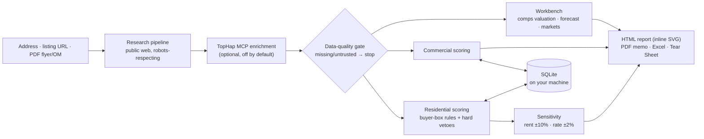

<p align="center">
  
</p>

<p align="center">
  <strong>Screen a real-estate deal end to end — every number with its source attached.</strong><br>
  An underwriting desk that gathers the public record, scores the deal, and shows its work.
</p>

<p align="center">
  <a href="LICENSE"></a>
  <a href="https://github.com/HUIIIM/vertciti-dealdesk/actions/workflows/ci.yml"></a>
  <a href="https://github.com/HUIIIM/vertciti-dealdesk/actions/workflows/gitleaks.yml"></a>
  <a href="https://vertciti-dealdesk.vercel.app"></a>
  
</p>

<p align="center">
  <a href="README.zh.md">中文版</a> · <a href="https://vertciti-dealdesk.vercel.app">Live demo</a> · <a href="https://vertciti.com">vertciti.com</a> · <a href="https://github.com/HUIIIM">Author</a>
</p>

> The old way: a broker flyer lands, and the next two hours disappear into
> spreadsheets, five data sites, and numbers you can't trace back to anything.
> DealDesk: paste the address, and the desk gathers the public record itself,
> scores the deal against written rules, and pins a source to every figure —
> what it can't find, it marks missing instead of inventing it.

## Demo — a real run, not a mockup


*Recorded live on 2026-10-20 against a local instance of this exact code.
The subject is a real Astoria, NY duplex whose public record was gathered
the same day by the production intake (TopHap via MCP: 28 fields with
sources). The walkthrough values it from its 10 real comparable sales,
runs the 5-year scenarios, then opens a built-in demo project's stored
score and the HTML report it generates. Captions on each still below.*

**The intake's subject — a real duplex, public-record figures, nothing staged:**


**Ten real comparable sales become a reconciled estimate ($1,211,530).
Note the income approach: rent isn't in the public record, so the desk
says "manual needed" — it never fills the gap with a guess:**


**Five-year scenarios ride on the estimate (a scenario is a hypothesis,
never a promise — the API says so itself):**


**A scored deal, dimension by dimension — the report at the end is a real
17 KB HTML file with three inline SVG charts, generated in the same run:**


**The product UI itself — the mode picker every run starts from
(residential plain-language mode vs. commercial pro mode):**


**The same Astoria duplex as a finished one-page decision sheet in the
web UI — a live intake at a $1,150,000 ask. The verdict is a PASS:
deal score 43/100, confidence 64.2, and because rent data is missing the
sheet says DSCR cannot be underwritten and downgrades itself instead of
rounding up:**


<sub>UI captures, 2026-10-20: browser screenshots of a local instance of
this repo's code (seed-DB copy), Chromium via Playwright — capture basis
registered in `assets/ASSETS.md`.</sub>

## What it does

- **Smart intake, three doors in** — a bare address, a listing URL, or a
  PDF flyer / offering memorandum. The pipeline gathers public listings,
  public records, taxes, schools, and neighborhood data; every field
  carries its source, fetch time, and a confidence grade.
  Seller-supplied figures are labeled *seller's figures — unverified*
  and stay labeled. ([demo](#demo--a-real-run-not-a-mockup))
- **A data-quality gate before any math** — missing key fields or an
  untrusted source stops the deal at the door with a "needs manual input"
  list. Dirty data never reaches the model.
- **Two scoring engines, written rules** — residential and commercial
  tracks score independently (grades A / B / C / reject), with hard
  vetoes floated to the top in red: floating rates, a balloon inside
  five years, no exit plan, pro-forma rent with no comps behind it.
  Every point traces to a written rule in the code — the rules are the
  code, not tuning knobs.
- **Full cash-to-close, every time** — down payment + closing costs +
  first-year capex + reserves, summed automatically. No line item
  quietly forgotten.
- **Sensitivity in five bands** — rent ±10%, rate ±2%: watch cash flow,
  cash-on-cash, DSCR, and entry cap move before the market does it for you.
- **A workbench next to the desk** — comps valuation (distance-weighted,
  reconciled with the income approach), market research on embedded
  public FHFA index data, and a six-dimension market report; one click
  sends a workbench result into the scoring engine.
  ([valuation still](#demo--a-real-run-not-a-mockup))
- **Reports that travel** — an interactive HTML report with inline SVG
  charts (zero plotting dependencies), a PDF underwriting memo, an
  Excel model, and a one-page Tear Sheet PDF for partners. Same numbers,
  same source, every format.
- **Side-by-side compare** — up to three projects in one table: CoC,
  DSCR, payback period in the same columns.

## Why it's cheaper / freer

DealDesk is MIT-licensed and self-hosted: no subscription, no per-seat
or per-deal fee, and your deal data lives in a SQLite file on your own
machine — it is never uploaded anywhere. The one optional paid layer is
TopHap public-record enrichment (off by default; priced by TopHap, not
by us). What it replaces is the manual ritual: hours of spreadsheet
underwriting and tab-hopping per deal, with numbers you couldn't audit
afterwards.

## Quick start (≤5 minutes, verified 2026-10-20)

```bash
git clone https://github.com/HUIIIM/vertciti-dealdesk.git && cd vertciti-dealdesk
./run.sh        # creates the venv, installs deps, inits the DB, serves
```

Open **http://127.0.0.1:8100** — create a project, and the first score is
about three minutes away. (Verified end-to-end on 2026-10-20:
`./run.sh` brings the app up and `GET /api/health` answers
`{"ok": true, "service": "dealdesk"}`.)

Manual equivalent:

```bash
python3 -m venv .venv && .venv/bin/pip install -r requirements.txt
.venv/bin/python -c "from app import db; db.init_db()"
.venv/bin/uvicorn app.main:app --host 127.0.0.1 --port 8100
```

Run the tests (delete the dev by-product DB first — a known test-isolation
quirk, documented in [AGENTS.md](AGENTS.md); 573 passed, run 2026-10-20):

```bash
rm -f dealdesk.db
PYTHONPATH=. .venv/bin/pytest tests/ -q
```

## Architecture



## The honesty contract

This is a screening aid, **not investment advice**, and it is built to
refuse the usual shortcuts:

- Every field shows its source, fetch time, and confidence. What can't
  be fetched is rendered as missing — never as a plausible-looking
  number. (In the demo above, the income approach returns N/A because
  rent is not a public-record field.)
- Listing-page and PDF figures are *seller's figures — unverified*
  until independently checked.
- Public pages only, `robots.txt` respected; when a site blocks the
  fetch, the pipeline stops, logs it, and degrades to manual entry.
- Before any real signing, closing, or tax filing, a licensed local
  real-estate attorney, a CPA, and a title company review the deal.
  The desk screens; professionals close.

## Status — where it stands (2026-10-20)

DealDesk is vertciti's working showcase, built for an audience of one
(Miao) and run in production at
[vertciti-dealdesk.vercel.app](https://vertciti-dealdesk.vercel.app).
It improves on a daily cadence — one backlog item implemented, tested,
deployed, and production-smoked every day (the log lives in
[docs/improvement-backlog.md](docs/improvement-backlog.md)).

- **Test suite: 573 passed** (1 pre-existing deselect), re-run
  2026-10-20. Charts are all inline SVG / embedded PNG — zero plotting
  dependencies.
- **Primary data source in production: TopHap** (public-record
  aggregation over MCP — valuation reference with range, loan and
  title history, tax assessments, foreclosure signals, comparable
  sales), verified live on 2026-10-20. The public-web pipeline and a
  U.S. Census geocoder act as fallbacks.
- **RentCast: adapter built, not active.** It stays off until its
  account is funded — an external blocker, stated plainly rather than
  papered over.
- **Known limits:** the public-web search layer is at the mercy of
  search-engine anti-bot walls (when blocked, fields degrade to
  "manual needed" — visible in the run log, never silent); scanned-PDF
  OCR exists but complex two-column offering memoranda are flagged
  for human review instead of being guessed at.

## Roadmap (planned — labeled, not shipped)

- **One-sentence verdict entry** — ask in natural language; the desk
  orchestrates comps → underwriting → tear sheet and answers with a
  cited decision.
- **Buy-box auto-scoring** — your written constraints as config;
  incoming deals scored against them automatically.
- **Deal watchlist** — tracked deals re-valued weekly, with drift alerts.
- **DealDesk MCP server** — pipeline, comps, and underwriting results
  queryable by an AI agent in natural language.

Direction and receipts: [ROADMAP.md](ROADMAP.md) ·
[docs/improvement-backlog.md](docs/improvement-backlog.md)

## Contributing

Issues and PRs welcome. Start with [CONTRIBUTING.md](CONTRIBUTING.md);
the house rules are simple: tests pin the headline numbers, comments
state their assumptions, and no figure is ever fabricated.

## License

MIT — see [LICENSE](LICENSE). Created by Jiahui Miao
([vertciti](https://vertciti.com)).

---

[vertciti.com](https://vertciti.com) · [github.com/HUIIIM](https://github.com/HUIIIM)
