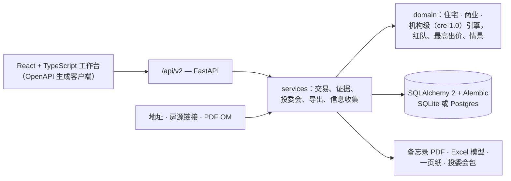

# DealDesk

**机构级承销，每个数字都有出处。**

DealDesk 把一笔交易从一个地址或一份发行备忘录，一路做到投委会材料，全在一个系统里：
逐租约现金流、完整资本结构与 GP / LP 分配瀑布、找出“哪条假设最要命”的红队，以及投委会可以逐分核对的完整留痕。
自部署、开源（MIT），由 [vertciti](https://vertciti.com) 出品。

| | |
|---|---|
| 状态 | 生产：**v2.0.0**（`/api/v2/health`，2026-10-23 核对）。评审中：**2.1.0**——机构级承销引擎 cre-1.0（[CHANGELOG](CHANGELOG.md)） |
| 质量门 | 每个 PR 跑 CI：pytest（覆盖率 ≥85%，含 v1 金标准）、ruff、mypy strict、Postgres 套件、前端类型检查 / lint / 单元测试、Playwright E2E（含 axe）、CodeQL、依赖审查、pip-audit / npm audit、gitleaks、OpenSSF Scorecard |
| 部署 | 自部署：Python 3.10+，默认 SQLite，`DATABASE_URL` 接 Postgres；生产实例部署在 Vercel |
| 生产实例 | [vertciti-dealdesk.vercel.app](https://vertciti-dealdesk.vercel.app/app/)：创始人自用的 v2 工作台，登录仅对操作人与受邀朋友开放，无公开注册。 |
| 接口 | Web 工作台（`/app/`）· HTTP API（`/api/v2`，OpenAPI，Bearer 令牌） |
| 语言 | 产品界面与 API：中文 · English · README：[English](README.md) · 简体中文 |
| 许可证 | MIT（[LICENSE](LICENSE)） |
| 联系 | 漏洞报告：[SECURITY.md](SECURITY.md) · 产品：[vertciti.com](https://vertciti.com) |


## 为什么是 DealDesk

多数核保至今还活在一张别人无法审计的表格里：数字从经纪人宣传单上抄来，关键假设藏在隐藏页，
投委会被要求批准一组无从追溯的数字。DealDesk 反其道而行：让每个决策都能逐行站得住。

| | |
|---|---|
| **商业地产模型的深度** | 逐租约、逐户型按月现金流，夹层、再融资、施工贷，带 catch-up 与回拨的 GP / LP 瀑布；导出全表公式联动的 Excel 模型，重算结果与引擎一致。 |
| **审计级的纪律** | 每个数字带来源、页码、复核人与新鲜度；来源矛盾必须书面裁决；缺的数据保持缺失。 |
| **可以检验的判断** | 红队按“能让回报摆动多少”给假设排序；反方备忘录由固定规则生成，从不经 AI；每次运行可按编号重算。 |
| **数据握在自己手里** | 部署在你自己的基础设施上，SQLite 或 Postgres，角色权限与每次改动的审计日志；交易数据留在你自己的服务器上，唯一的付费数据集成默认关闭。 |

为自己做承销、要向投委会交代的投资者、家族办公室与小型投资团队而建——从住宅出租，到机构级写字楼、多户公寓与新建开发。

## 概述

DealDesk 如何把核保和证据放在一处：

- **每个数字有护照**：来源、页码、抽取方式、可信度、复核人、新鲜度。不同来源数值矛盾会自动登记，裁决必须写理由。
  缺的数据保持缺失（“—”），不补、不猜。
- **先核哪个由交易本身决定**：红队测出每条假设能让回报摆动多少，核对队列按摆动大小排序。
- **反方意见由规则生成，不经 AI**：反方备忘录列出淘汰条件命中、余量过薄、到期集中、再融资缺口等，每条附带背后的数字。
- **投委会看到的是冻结的数字**：投委会包与决策记录带运行编号和输入哈希，任何人可按编号重算，核对结果分毫不差。

本工具用于筛选与核保辅助，不构成投资建议。签约、交割或报税前，须由当地持牌房地产律师、CPA 与产权公司审核。

## 核保赛道

| 赛道 | 适用 | 引擎 |
|---|---|---|
| **住宅** | 1–4 户住宅与小型出租物业 | 买家清单规则与硬否决项、月供、现金回报、DSCR、全口径现金需求 |
| **商业** | 小型商业与商住混合 | 从租金表、T12 算到 NOI、资本化率、DSCR、IRR；敏感性区间 |
| **机构级**（2.1.0，评审中） | 写字楼 / 零售 / 工业、多户公寓、新建开发 | 逐租约或按户型逐月现金流；优先、夹层、再融资与施工贷；GP / LP 分配瀑布——见[方法论](docs/INSTITUTIONAL-ENGINE.md) |

### 机构级引擎（cre-1.0）

- **租约**：租金递增、免租、费用回收（NNN / 基年 / 全包）；到期按市场租赁假设加权续租或新租：空置月数、免租、TI 与佣金。
- **多户公寓**：户型表；loss-to-lease 随租约到期消化；翻新计划（停用、溢价、成本）；优惠、其他收入、翻房成本。
- **资本结构**：固定或 SOFR 曲线浮动利率（可设上限）、只付息期与摊还；夹层；再融资按 LTV、最低 DSCR、
  最低债务收益率三者取最小，并写明哪条约束卡住。
- **开发**：硬成本、软成本与不可预见费按直线或 S 曲线投放；施工贷（股权先投、利息资本化、按 LTC 封顶）；
  竣工后按去化速度出租；开发收益率与价值创造。
- **收益**：有 / 无杠杆 IRR（年度与按月）、权益倍数、NPV；退出按次年 NOI 原值或稳定化口径；
  分配瀑布支持多档 IRR 门槛、按年或按月分配、GP catch-up 与回拨。
- **可手算验证**：每条口径都有闭式解或手算用例（[方法论](docs/INSTITUTIONAL-ENGINE.md)）；
  Excel 模型在 CI 里用 LibreOffice 重算，必须与引擎逐格一致。

## 工作台

| | |
|---|---|
|  |  |
| 七个生命周期阶段的流水线 | 红队：哪条假设最能左右回报 |
|  |  |
| 机构级写字楼模型：结果、再融资、瀑布、逐年现金流 | 新建多户公寓：开发成本、施工贷、再融资 |

截图来自本仓库代码的本地实例，使用仓库自带的示例输入；采集口径登记在 [assets/ASSETS.md](assets/ASSETS.md)。

## 功能

| 模块 | 做什么 |
|---|---|
| **信息收集** | 地址、房源链接或 PDF 宣传单 / OM。公开房源、公共记录、税、学区与社区数据；候选字段逐条采用并登记数字护照。卖方提供的数字始终标注“卖方口径，未核实”。 |
| **核保** | 版本化：每次保存是不可改的快照，带运行编号；任意两个版本可对比。 |
| **风险** | 红队（±10% 冲击按摆动排序）、情景加权、按每条淘汰条件反推最高出价并写明卡价约束、反方备忘录。 |
| **生命周期** | 七个阶段与关卡（不能跳阶段，回退须写原因）、任务、审批（付款仅董事长、不能自批）、投委会投票、冻结数字的决策日志、持有期事后归因。 |
| **报告** | 投资备忘录 PDF；三条赛道都有 Excel 模型（`GET /api/v2/deals/{id}/export/model`）——住宅与商业的月供、DSCR、债务收益率、IRR、倍数为 Excel 原生公式，机构级为全表公式联动的承销模型；一页纸 Tear Sheet；带内容哈希的投委会包。 |
| **工作台体验** | 流水线看板与表格、2–4 笔并排比较、⌘K 命令面板与快捷键、密度与暗色模式、手机端只读、中英切换。 |

## 快速开始

```bash
git clone https://github.com/HUIIIM/vertciti-dealdesk.git && cd vertciti-dealdesk
./run.sh        # 自动建虚拟环境、装依赖、初始化数据库，服务跑在 :8100
```

打开 http://127.0.0.1:8100/app/。`GET /api/v2/health` 返回版本、引擎版本与数据库状态。
Postgres：`DATABASE_URL=postgresql://… ./run.sh`（迁移自动执行）。

测试（先删开发库，见 [AGENTS.md](AGENTS.md)）：

```bash
rm -f dealdesk.db && .venv/bin/pytest -q          # 后端
cd frontend && npm ci && npm test && npm run e2e   # 前端单元测试 + Playwright E2E
```

## 架构



分层、可复现等设计决策记录在 [docs/adr/](docs/adr/)；运维见[运维手册](docs/RUNBOOK.md)；产品对象与规则见
[docs/PRODUCT-LOGIC.md](docs/PRODUCT-LOGIC.md)。

## 安全与合规

- 自部署：交易数据留在你自己基础设施上的数据库里。唯一可选的付费外部数据是 TopHap 公共记录补全，默认关闭。
- 角色（董事长 / 分析 / 只读）、Bearer 令牌只存哈希、错令牌限流、每次状态变化留改前改后的审计日志、
  安全响应头与严格 CSP、带请求编号的 JSON 日志、备份与恢复工具。
- 只抓公开页面并遵守 `robots.txt`；被拦截时退回手工录入。
- 漏洞请按 [SECURITY.md](SECURITY.md) 私下报告。

## 现状与局限

DealDesk 是 vertciti 的在用样板，生产实例在 [vertciti-dealdesk.vercel.app](https://vertciti-dealdesk.vercel.app/app/)。

- 生产运行 **2.0.0**；机构级赛道（**2.1.0**）评审中，尚未部署。
- 机构级导出（Excel 模型、投委会备忘录）目前只有中文；界面与 API 已双语。
- 机构级范围（cre-1.0）不含 CPI 递增、百分比租金、费用上限、欧式瀑布、多次再融资与夹层 PIK——完整清单见[方法论](docs/INSTITUTIONAL-ENGINE.md)。
- 生产主数据源：TopHap（MCP）。RentCast 适配器已建，待账户付费后启用。公开网页搜索可能被反爬拦截，受影响字段降级为“需手工”。

## 路线图（计划中，未交付）

- **买家清单自动打分**：书面约束写成配置，新交易自动对照打分。
- **交易关注列表**：跟踪中的交易每周重估，偏离即提醒。
- **DealDesk MCP Server**：流水线、可比与核保结果可被 AI 智能体查询。

方向：[ROADMAP.md](ROADMAP.md) · [docs/improvement-backlog.md](docs/improvement-backlog.md)

## 文档 · 支持 · 许可证

- [CHANGELOG.md](CHANGELOG.md) · [ROADMAP.md](ROADMAP.md) · [docs/RUNBOOK.md](docs/RUNBOOK.md) ·
  [docs/INSTITUTIONAL-ENGINE.md](docs/INSTITUTIONAL-ENGINE.md) · [docs/adr/](docs/adr/) ·
  [docs/PRODUCT-LOGIC.md](docs/PRODUCT-LOGIC.md)
- 参与贡献：[CONTRIBUTING.md](CONTRIBUTING.md)。测试锁定关键数字，注释写明假设，不编造任何数字。
- 许可证：MIT，见 [LICENSE](LICENSE)。作者 Jiahui Miao。

---

Built by [vertciti](https://vertciti.com) — https://vertciti.com
