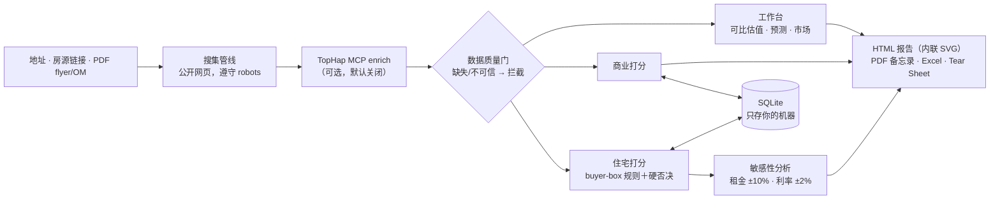

# DealDesk

自部署的房地产核保台，面向个人投资者和小型投资团队：按地址搜集一处房产的公共记录，按书面规则给交易打分，
每个数字都标注来源。

| | |
|---|---|
| 状态 | 活跃：v1.0.0（`pyproject.toml`）；v2 交易工作台在 [CHANGELOG](CHANGELOG.md) 中记为 2.0.0、未发布。CI 覆盖 pytest、ruff、mypy、Postgres 套件、前端类型检查 / lint / 单元测试、Playwright E2E（含 axe）、CodeQL、依赖审查、pip-audit / npm audit、gitleaks 和 OpenSSF Scorecard |
| 部署 | 自部署：Python 3.10+，默认 SQLite（支持 Postgres）；生产实例部署在 Vercel |
| 在线演示 | [vertciti-dealdesk.vercel.app](https://vertciti-dealdesk.vercel.app/app/)：v2 工作台的生产实例，查看数据需要登录 |
| 接口 | Web 界面（v2 工作台在 `/app/`）· HTTP API（`/api`、`/api/v2`，Bearer 令牌） |
| 许可证 | MIT（[LICENSE](LICENSE)） |
| 语言 | [English](README.md) · 简体中文 |
| 联系 | 安全漏洞：[SECURITY.md](SECURITY.md) · 产品：[vertciti.com](https://vertciti.com) |


## 概览

投资人筛一笔交易，通常从中介的 flyer 开始，花几个小时在电子表格和数据网站之间搬数字，最后得到一堆追溯不到出处的
数字。DealDesk 接受纯地址、房源链接或 PDF（flyer、OM），搜集公开房源、公共记录、税费、学校与周边数据；关键字段
缺失时在数据质量门前停下。通过的交易按住宅或商业规则打分，附敏感性分析和全口径现金需求。每个字段带来源、抓取时间
和可信度；抓不到的显示为缺失，不填数。

这是筛选辅助工具，不构成投资建议。任何签约、交割或报税前，须经持牌本地房地产律师、CPA 和 title company 审查。

## 演示：真实运行


2026-10-20 录制，对象是本仓代码的本地实例。标的是纽约 Astoria 一栋真实的双拼住宅，其公共记录由生产环境 intake
于同日搜集（TopHap 经 MCP，28 个带来源字段）。演示用它的 10 条可比成交做估值、跑 5 年情景预测，再打开内置演示
项目的已存打分和它生成的 HTML 报告。

- **搜集**：标的房产及其公共记录数字。
  
- **估值**：10 条可比成交调和出估值 $1,211,530。租金不在公共记录里，收益法一栏写"需手动补"，不拿猜测填空。
  
- **预测**：在估值之上跑 5 年情景；API 把情景标注为假设。
  
- **打分与报告**：逐维打分，以及同一轮运行生成的 HTML 报告（内联 SVG 图表）。
  
- **v1 网页界面**：模式选择（住宅小白模式、商业专业模式），以及同一栋双拼在要价 $1,150,000 时的决策单页：结论
  PASS，deal 评分 43/100，置信度 64.2。因缺租金数据，单页写明 DSCR 无法核保，并主动降一档。
  

界面截图，2026-10-20：本仓代码本地实例（种子库副本）的浏览器实拍，Chromium + Playwright；拍摄口径登记于
[assets/ASSETS.md](assets/ASSETS.md)。截图是 v1 界面；[CHANGELOG](CHANGELOG.md) 记录 v2 下线了 v1 单页，旧地址
跳转到 `/app/`。

## 能力一览

| 环节 | 能力 |
|---|---|
| **搜集** | 地址、房源链接或 PDF（flyer、OM）。公开房源、公共记录、税费、学校与周边数据；每个字段带来源、抓取时间和可信度。卖方给的数字一律标"卖方口径、待验证"。 |
| **数据质量门** | 缺关键字段或来源不可信时，在任何计算之前拦下，并给出"需手动补"清单。 |
| **打分** | 住宅、商业双轨独立打分（A / B / C / 不收录）。硬否决项置顶：浮动利率、5 年内 balloon、无退出预案、无可比支撑的 pro-forma 租金。每一分都能指到代码里的书面规则。 |
| **现金需求** | 每笔交易自动汇总首付、交割费、首年 capex 和储备金。 |
| **敏感性分析** | 租金 ±10%、利率 ±2% 分档，看现金流、CoC、DSCR 和入场 cap 的变化。 |
| **工作台** | 可比成交估值（距离加权，与收益法调和）、基于内置 FHFA 公开房价指数的市场调查、六维市场报告；结果可送入打分引擎。 |
| **报告** | 带内联 SVG 图表的 HTML 交互报告、核保备忘录 PDF、Excel 模型、一页纸 Tear Sheet PDF，各格式数字同源。 |
| **对比** | 最多 3 个项目并排：CoC、DSCR、回本周期。 |
| **v2 交易工作台**（`/app/`） | 流水线（看板 / 表格）和交易页：结论卡、核对进度，标签页含租金表、T12、模型、红队、市场、文件与证据、投委会、持有、日志。每个数字有"护照"（来源、页码、抽取方式、可信度、复核人、新鲜度）；来源冲突须写理由裁决。按 IRR / DSCR / 现金回报目标反推最高出价，并写明卡价约束。七阶段生命周期与关卡、投委会投票与投委会包、冻结数字的决策日志、持有期事后归因。角色（董事长 / 分析 / 只读）、审计日志、键盘优先、暗色模式、手机只读。v1 计算不变，每次测试都与录制输出逐一比对（[ADR 0001](docs/adr/0001-golden-master.md)）。 |

## 快速开始

```bash
git clone https://github.com/HUIIIM/vertciti-dealdesk.git && cd vertciti-dealdesk
./run.sh        # 自动建虚拟环境、装依赖、初始化数据库并启动
```

浏览器打开 http://127.0.0.1:8100 新建项目。`GET /api/health` 返回 `{"ok": true, "service": "dealdesk"}`。

手动等价方式：

```bash
python3 -m venv .venv && .venv/bin/pip install -r requirements.txt
.venv/bin/python -c "from app import db; db.init_db()"
.venv/bin/uvicorn app.main:app --host 127.0.0.1 --port 8100
```

跑测试（先删开发副产品库，这是已知的测试隔离问题，见 [AGENTS.md](AGENTS.md)）：

```bash
rm -f dealdesk.db
PYTHONPATH=. .venv/bin/pytest tests/ -q
```

## 架构



v2 采用 domain / services / api 分层、SQLAlchemy 2 + Alembic（SQLite 或 Postgres）、TypeScript + React 前端与
OpenAPI 生成的客户端。设计决策见 [docs/adr/](docs/adr/)；运维见[运维手册](docs/RUNBOOK.md)和
[docs/PRODUCT-LOGIC.md](docs/PRODUCT-LOGIC.md)。

## 安全与合规

- 自部署：交易数据存在你自己基础设施上的数据库里。唯一可选的外部付费层是 TopHap 公共记录 enrich，默认关闭，按
  TopHap 自己的定价。
- v2：角色（董事长 / 分析 / 只读）、Bearer 令牌只存哈希、错令牌限流、审计日志、安全响应头与严格 CSP、带请求编号的
  JSON 日志。
- 采集只碰公开页面、遵守 `robots.txt`；被拦截时停手并记录，降级为手动录入。
- 房源页和 PDF 的数字在独立验证前一律标"卖方口径、待验证"。
- 安全漏洞请按 [SECURITY.md](SECURITY.md) 私下报告。

## 现状与边界

DealDesk 是 vertciti 的实作展示品，为一位使用者而建，生产实例在
[vertciti-dealdesk.vercel.app](https://vertciti-dealdesk.vercel.app/app/)。改进记录见
[docs/improvement-backlog.md](docs/improvement-backlog.md)。

- **生产主数据源：TopHap**（公共房产记录聚合，经 MCP：估值参考与区间、贷款与产权历史、计税估值、法拍信号、可比
  成交），2026-10-20 实测连通。公开网页管线和美国 Census 地理编码为保底。
- **RentCast：适配器已建、未激活**，账号付费落地前保持关闭，这是外部阻塞。
- 公开网页搜索层受制于搜索引擎的反爬墙；被拦时字段降级为"需手动补"，运行日志可见。
- 扫描版 PDF 已有 OCR，但双栏复杂版式的 OM 会标注人工复核，不硬猜。
- v2 在 [CHANGELOG](CHANGELOG.md) 中记为未发布（2.0.0）。

## 路线图（规划中，未上线）

- **一句话投决入口**：自然语言提问，编排可比 → 承销 → tear sheet，返回带引用的决策建议。
- **Buy-box 自动打分**：书面约束写成配置，进来的交易自动按它打分。
- **Deal watchlist**：跟踪中的交易每周重跑估值，带漂移提醒。
- **DealDesk MCP 服务**：pipeline、可比和承销结果供 AI agent 查询。

方向：[ROADMAP.md](ROADMAP.md) · [docs/improvement-backlog.md](docs/improvement-backlog.md)

## 文档 · 支持 · 许可证

- [CHANGELOG.md](CHANGELOG.md) · [ROADMAP.md](ROADMAP.md) · [docs/RUNBOOK.md](docs/RUNBOOK.md) ·
  [docs/adr/](docs/adr/) · [docs/PRODUCT-LOGIC.md](docs/PRODUCT-LOGIC.md)
- 贡献：[CONTRIBUTING.md](CONTRIBUTING.md)。测试钉住关键数字，注释写明假设，不编造任何数字。
- 安全：[SECURITY.md](SECURITY.md)。
- 许可证：MIT，见 [LICENSE](LICENSE)。作者 Jiahui Miao。

---

Built by [vertciti](https://vertciti.com) — https://vertciti.com
