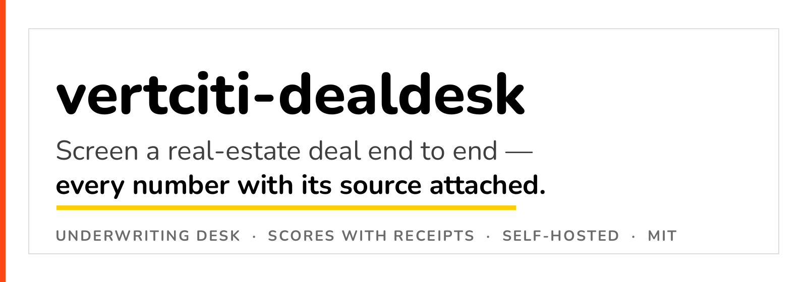
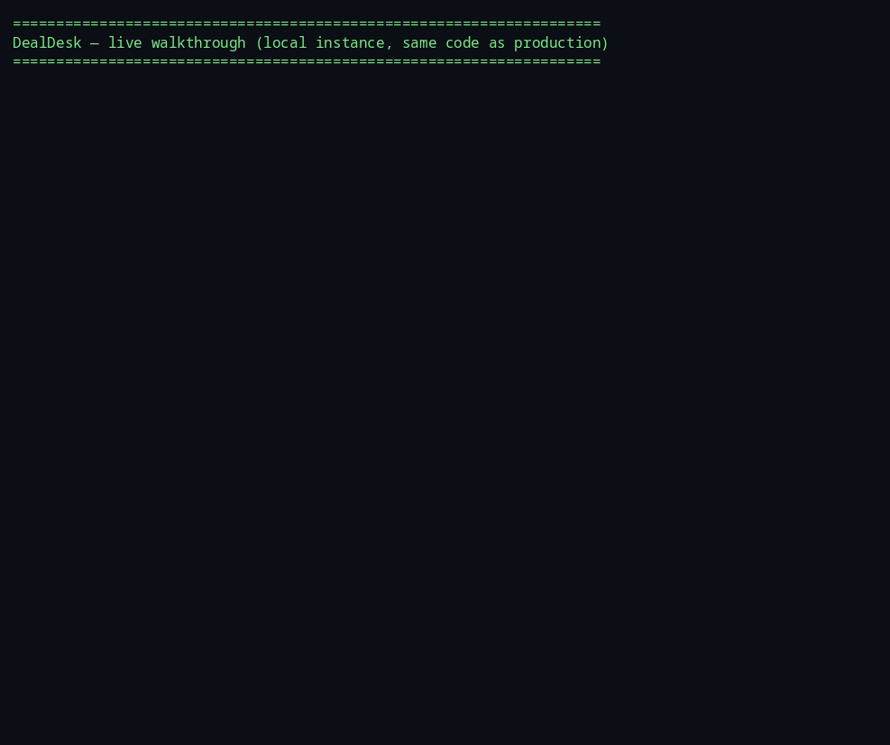
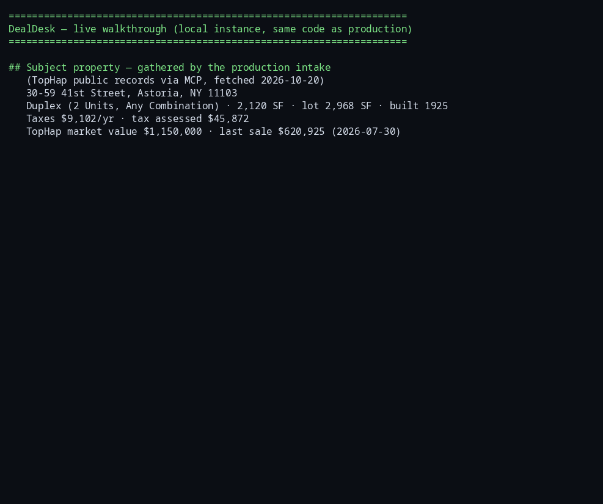
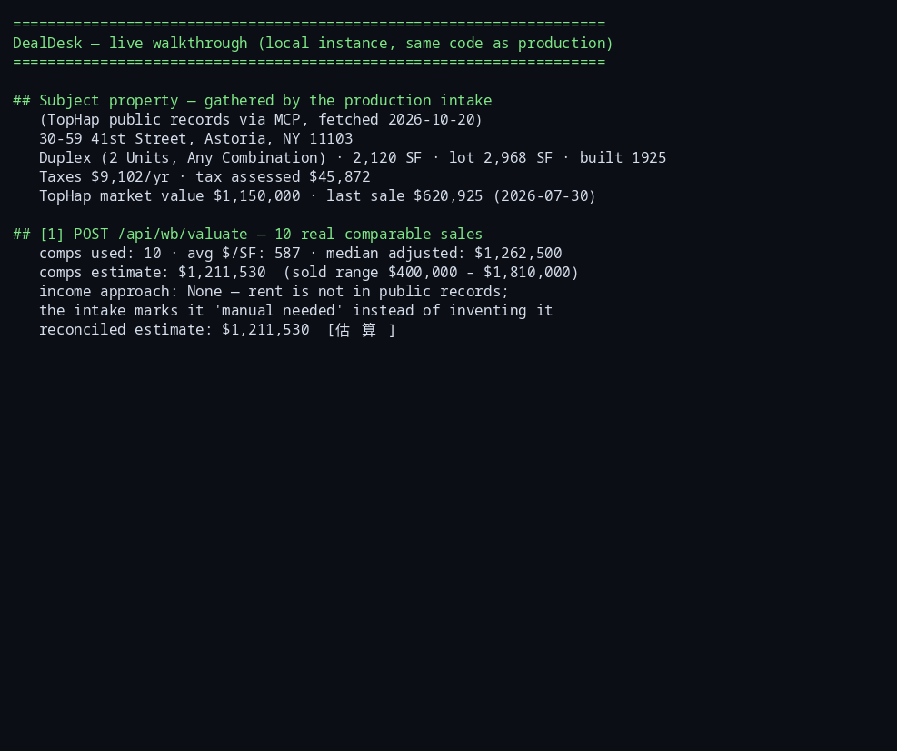
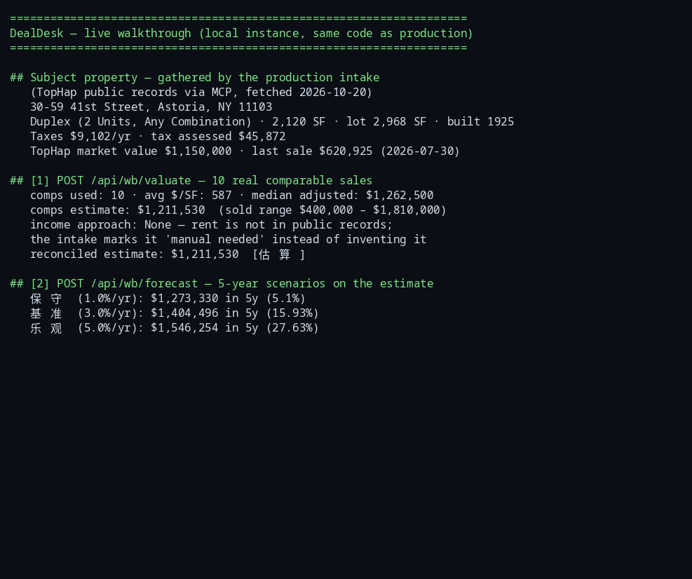
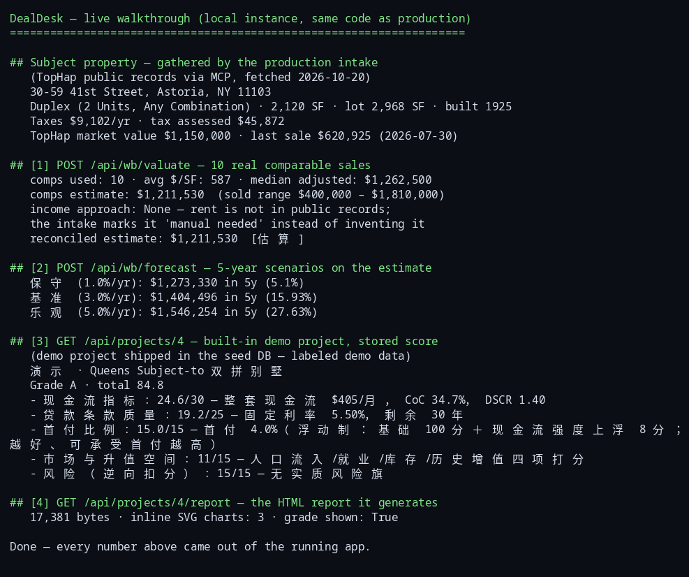
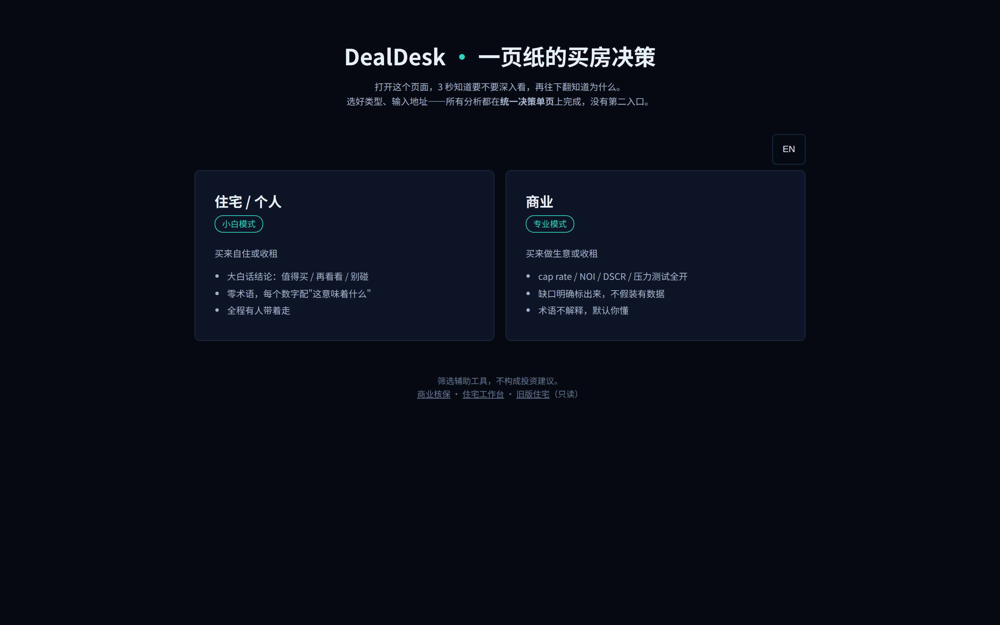
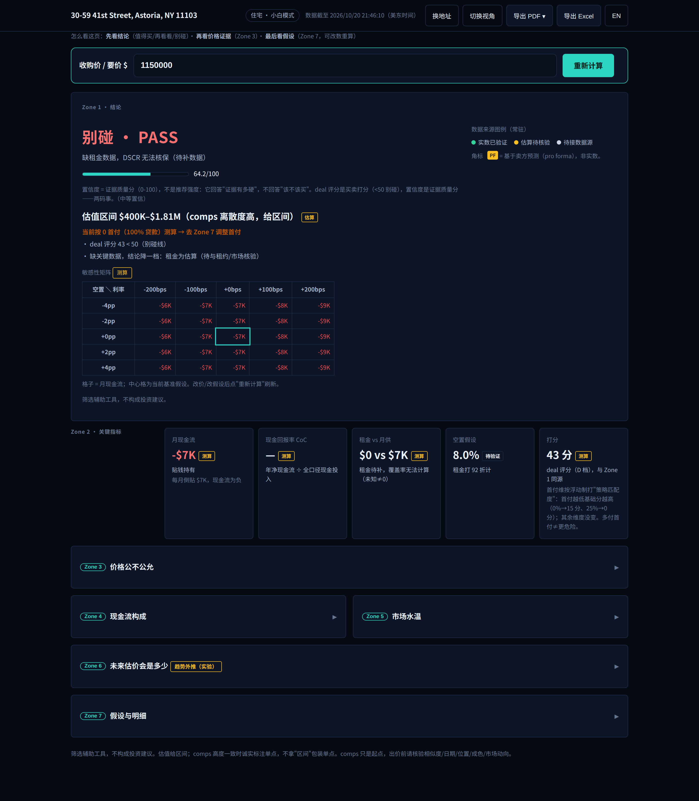
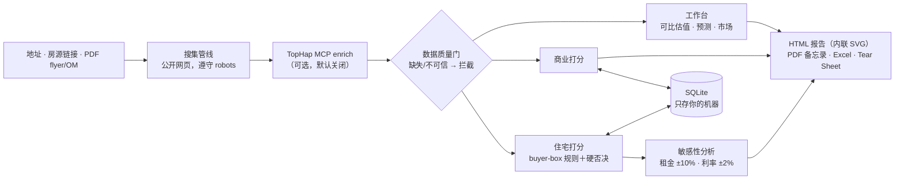

<p align="center">
  
</p>

<p align="center">
  <strong>一笔房地产交易从录入到结论 — 每个数字都标注来源。</strong><br>
  一张会自己搜集公共记录、按书面规则打分、并把依据摊开给你看的核保台。
</p>

<p align="center">
  <a href="LICENSE"></a>
  <a href="https://github.com/HUIIIM/vertciti-dealdesk/actions/workflows/ci.yml"></a>
  <a href="https://github.com/HUIIIM/vertciti-dealdesk/actions/workflows/gitleaks.yml"></a>
  <a href="https://vertciti-dealdesk.vercel.app"></a>
  
</p>

<p align="center">
  <a href="README.md">English</a> · <a href="https://vertciti-dealdesk.vercel.app">在线演示</a> · <a href="https://vertciti.com">vertciti.com</a> · <a href="https://github.com/HUIIIM">作者</a>
</p>

> 老办法：中介的 flyer 一到，接下来两小时消失在电子表格、五个数据网站和一堆
> 追溯不到出处的数字里。
> DealDesk：粘贴地址，核保台自己搜集公共记录，按书面规则打分，每个数字钉上
> 来源 — 抓不到的标注缺失，绝不编一个填上。

## 演示 — 真实运行，不是样片



*2026-10-20 录制，对象是与生产同代码的本地实例。标的是一栋真实的纽约
Astoria 双拼住宅：其公共记录由生产环境 intake 于同日搜集（TopHap 经 MCP，
28 个带来源字段）。演示用它 10 条真实可比成交做估值、跑 5 年情景预测，
再打开内置演示项目的已存打分与它生成的 HTML 报告。每张截图下方有说明。*

**intake 的标的 — 一栋真实双拼，公共记录数字，无一摆拍：**



**10 条真实可比成交调和出估值（$1,211,530）。注意收益法一栏：租金不在
公共记录里，核保台写的是"需手动补" — 它不拿猜测填空：**



**5 年情景预测挂在估值之上（情景是假设、不是承诺 — API 自己也是这么写的）：**



**一笔已打分的交易，逐维摊开 — 结尾的报告是同一轮运行真实生成的
17 KB HTML 文件，内嵌 3 张 SVG 图表：**



**产品界面本身 — 每次运行的起点：住宅/商业模式选择（小白模式 vs 专业模式）：**



**同一套 Astoria 双拼在网页界面里的完整决策单页 — 实时 intake、要价
$1,150,000。结论是「别碰 · PASS」：deal 评分 43/100、置信度 64.2；
因缺租金数据，单页明说 DSCR 无法核保并主动把结论降一档，而不是
凑一个好看的数：**



<sub>界面截图，2026-10-20：本仓代码本地实例（种子库副本）的浏览器
实拍，Chromium + Playwright；拍摄口径登记于 `assets/ASSETS.md`。</sub>

## 它能干什么

- **智能搜集 intake，三门任选** — 纯地址、房源链接、或 PDF（flyer、OM）。
  管线自动搜集公开房源、公共记录、税费、学校与周边数据；每个字段带
  来源＋抓取时间＋可信度。卖方给的数字一律标注"卖方口径、待验证"，
  标了就不摘。（[看演示](#演示--真实运行不是样片)）
- **进模型之前先过数据质量门** — 缺关键字段或来源不可信，交易当场被拦，
  附一份"需手动补"清单。脏数据进不了模型。
- **双轨打分引擎，规则成文** — 住宅／商业双轨独立打分（A / B / C / 不收录
  四档），硬否决项红色置顶：浮动利率、5 年内 balloon、无退出预案、
  无可比支撑的 pro-forma 租金。每条分都能指到代码里的书面规则条目 —
  规则就是代码，不是调出来的参数。
- **全口径现金需求，一次算清** — 每笔 deal 自动汇总首付＋交割费＋
  首年 capex＋储备金，不漏项。
- **敏感性分析五档 what-if** — 租金 ±10%、利率 ±2%：现金流、CoC、
  DSCR、入场 cap 怎么变，先看清楚再等市场替你变。
- **核保台旁边的全面分析工作台** — 可比成交估值（距离倒数加权，
  与收益法调和）、基于内置 FHFA 公开房价指数的市场调查、六维市场
  报告；测算结果一键送入打分引擎。（[看估值截图](#演示--真实运行不是样片)）
- **能带走的报告** — 带内联 SVG 图表的 HTML 交互报告（零绘图依赖）、
  核保备忘录 PDF、承销模型 Excel、给合伙人看的一页纸 Tear Sheet PDF。
  数字同源，格式任选。
- **项目并排对比** — 最多 3 个项目同表对比：CoC、DSCR、回本周期同列，
  差距一目了然。

## 为什么更便宜 / 更自由

DealDesk 是 MIT 开源、自托管：没有订阅费、没有按席位或按笔收费，
你的交易数据只存本机一个 SQLite 文件 — 从不上传任何地方。唯一可选的
付费层是 TopHap 公共记录 enrich（默认关闭，按 TopHap 自己的定价，
不经我们）。它替代的是那套手工作业：每笔 deal 数小时的表格核保＋
多站比价，而且算完还无法审计。

## 快速开始（≤5 分钟，2026-10-20 实测）

```bash
git clone https://github.com/HUIIIM/vertciti-dealdesk.git && cd vertciti-dealdesk
./run.sh        # 自动建虚拟环境、装依赖、初始化数据库并启动
```

浏览器打开 **http://127.0.0.1:8100** — 新建一个项目，第一份打分约
3 分钟可见。（2026-10-20 端到端实测：`./run.sh` 拉起应用，
`GET /api/health` 返回 `{"ok": true, "service": "dealdesk"}`。）

手动等价方式：

```bash
python3 -m venv .venv && .venv/bin/pip install -r requirements.txt
.venv/bin/python -c "from app import db; db.init_db()"
.venv/bin/uvicorn app.main:app --host 127.0.0.1 --port 8100
```

跑测试（先删开发副产品库 — 已知的测试隔离 quirk，见
[AGENTS.md](AGENTS.md);2026-10-20 实测 573 passed):

```bash
rm -f dealdesk.db
PYTHONPATH=. .venv/bin/pytest tests/ -q
```

## 架构



## 诚实约定

这是筛选辅助工具，**不构成投资建议**，并且它被刻意做成拒绝走捷径的样子：

- 每个字段标注来源＋抓取时间＋可信度；抓不到的渲染为缺失 —
  绝不编一个看起来合理的数字。（上面演示里，收益法返回 N/A，
  因为租金不是公共记录字段。）
- 房源页 / PDF 的数字一律标"卖方口径、待验证"，独立验证先于任何结论。
- 只碰公开页面、遵守 robots.txt；被反爬拦截立刻停手并记录，
  降级走手动录入。
- 每笔真实交易签约 / 交割 / 报税前，必须经持牌本地房地产律师、
  CPA / 税务师、title company 审查。核保台负责筛选，专业人士负责成交。

## 状态 — 现在到哪一步了（2026-10-20）

DealDesk 是 vertciti 的实作展示品，为一人（Miao）而建，生产在线：
[vertciti-dealdesk.vercel.app](https://vertciti-dealdesk.vercel.app)。
它按每日节奏改进 — 每天一项台账改进实现、上线并做生产冒烟
（日志见 [docs/improvement-backlog.md](docs/improvement-backlog.md)）。

- **测试全量：573 passed**（1 个 pre-existing deselect），2026-10-20
  复跑。图表全为内联 SVG / 嵌入 PNG — 零绘图依赖。
- **生产主数据源：TopHap**（公共房产记录聚合，MCP 协议 — 估值参考
  ＋区间、贷款与产权历史、计税估值、法拍预警、可比成交等），
  2026-10-20 实测连通。公开网页管线与美国 Census 地理编码为保底。
- **RentCast：适配器已建、未激活。** 账号付费未落地前保持关闭 —
  这是外部阻塞，如实写在这里，不拿话术盖过去。
- **已知边界：** 公开网页搜索层受制于搜索引擎的反爬墙（被拦时字段
  降级为"需手动补"，运行日志可见，绝不静默）；扫描版 PDF 已有 OCR，
  但双栏复杂版式的 OM 会被标注"人工复核"，不硬猜。

## 路线图（规划 — 标注清楚，未上线）

- **"一句话投决"入口** — 自然语言提问，核保台编排
  可比→承销→tear sheet 全链，返回带引用的决策建议。
- **Buy-box 自动打分** — 你的书面约束写成配置，进来的 deal 自动按它打分。
- **Deal watchlist** — 跟踪中的 deal 每周重跑估值，带漂移推送。
- **DealDesk MCP Server** — 把 pipeline、可比与承销结果暴露给 AI agent
  自然语言查询。

方向与凭证：[ROADMAP.md](ROADMAP.md) ·
[docs/improvement-backlog.md](docs/improvement-backlog.md)

## 贡献

欢迎 Issue 与 PR。先读 [CONTRIBUTING.md](CONTRIBUTING.md)；家规很简单：
测试必须钉住 headline 数字、代码注释如实标注假设、绝不编造数据。

## 许可证

MIT — 见 [LICENSE](LICENSE)。Created by Jiahui Miao
（[vertciti](https://vertciti.com)）。

---

[vertciti.com](https://vertciti.com) · [github.com/HUIIIM](https://github.com/HUIIIM)
