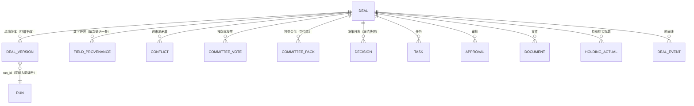
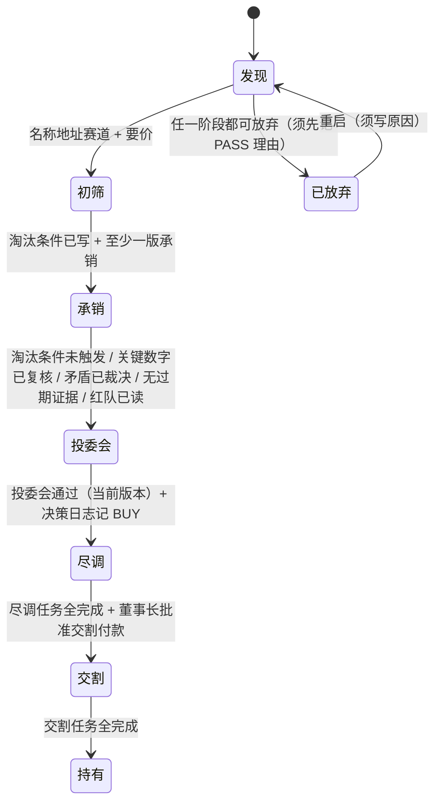
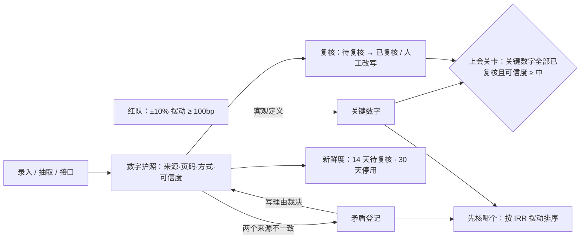
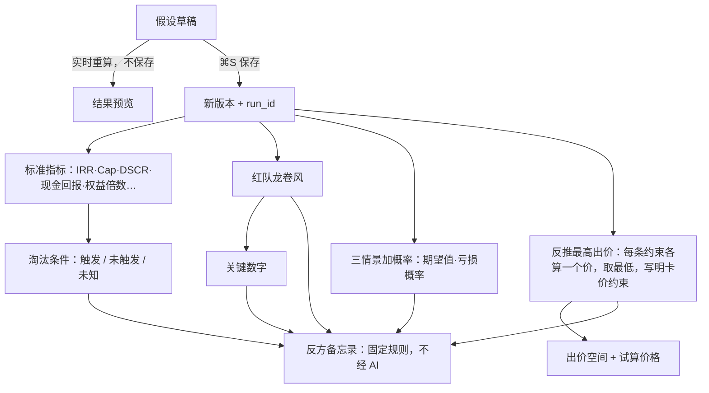

# DealDesk 产品运作逻辑（v2，2026-10-22）

> 这份文档回答三个问题：一笔交易在系统里怎么走、一个数字在系统里怎么活、谁能做什么。
> 每条规则都标了实现位置。**代码与本文不一致时以代码为准**，并应同步修正本文。

## 0. 一句话

DealDesk 把一笔房地产交易从“发现”带到“持有”。每走一步，系统都要求**证据够了才放行**：每个数字有来源，关键数字核过，底线没破，决定当时就冻结。目标不是算得更快，而是让投委会**不用重新核对**就敢用这些数。

## 1. 核心对象

| 对象 | 含义 | 关键规则 | 位置 |
|---|---|---|---|
| 交易 Deal | 一笔待评估或已买的物业 | 赛道三选一：住宅 / 商业 / 机构级（逐租约或按户型逐月，见 docs/INSTITUTIONAL-ENGINE.md）；淘汰条件在建交易时就要写 | `services/v2/deals.py` |
| 承销版本 DealVersion | 一次保存的全部假设与结果 | 只增不改；版本号递增；当前版本 = 最新保存的那版 | `deals.save_version` |
| 运行 Run | 引擎版本 + 规范化输入的哈希 | 同一编号重算，结果分毫不差（`/runs/{id}/verify`） | `domain/v2/reproducible.py` |
| 数字护照 FieldProvenance | 某字段的一条来源登记 | 来源、页码、抽取方式、可信度、复核状态、新鲜度；历史全保留 | `services/v2/evidence.py` |
| 矛盾 Conflict | 同一字段两个来源数值不一致 | 偏差超过容差就自动登记；裁决时必须写理由 | `domain/v2/provenance.py` |
| 投票 / 投委会包 | 针对某个版本 | 换了版本，之前的投票不再算数；包里印运行编号和内容哈希 | `services/v2/committee.py` |
| 决策 Decision | BUY / HOLD / PASS 加理由 | 冻结当时的指标、淘汰条件、核对进度、运行编号和输入哈希 | `workflow.log_decision` |
| 审计 AuditLog | 每次状态变化的改前与改后 | 谁、何时、改了什么；董事长可查 | `persistence/audit.py` |

## 2. 交易怎么走：七个阶段与关卡

- **只能逐级前进**，不能跳级；回退不设关卡，但**必须写原因**，记入时间线（`domain/v2/lifecycle.py: evaluate`、`workflow.advance`）。
- 每个关卡由若干检查项组成，状态用四个词表达：**已验证 / 建设中 / 计划中 / 风险**；全部“已验证”才放行。
- **未知不等于安全**：指标算不出来时，“淘汰条件未触发”这一项显示“建设中”，不放行。
- 交易页顶部永远显示“下一阶段还差什么”，所以没人需要去猜卡在哪。

## 3. 数字怎么活：从录入到可以上会

1. **关键数字不靠人拍脑袋**：红队面板把每个假设上下浮动 10%，能让主回报指标（商业看 IRR，住宅看现金回报）移动 100 个基点以上的，自动成为关键数字（`redteam.py`）。
2. **先核哪个**：每处待核都折算成“它能让主指标摆动多少基点”，然后排序。矛盾按两个来源的值分别实测；未复核的关键数字按 ±10% 的摆动计。同一个假设只列一次（`verification_value.py`）。
3. **未知保持未知**：没有来源的数显示“—”，不显示 0；算不出的指标不参与期望值；情景只要有一个算不出，期望值就显示未知（`scenarios.py`）。
4. **百分比口径**：一律用“百分比数”，15 就是 15%（全系统统一）。

## 4. 承销计算链

- **同一套改价规则**：反推最高出价、出价空间、试算价格都用 `max_bid.with_price`。住宅赛道改价时，首付和贷款额按原 LTV 同比例调整。
- **反推最高出价**：先粗搜，再二分，精确到 100 美元并向下取整。任何一条约束无法满足或算不出来，就不给可出价（`max_bid.py`）。
- **反方备忘录**只由已算出的结果拼成，同样的输入一定得出同样的备忘录。数据不够的论点直接不写（`devils_advocate.py`）。投委会包里也带这一节。

## 5. 决策链：从投委会到复盘

1. **投票**（`domain/v2/committee.py: tally`）：董事长一票否决；反对票多于赞成票则不通过；董事长投了赞成、且赞成票不少于反对票，才算通过；其余情况都是“待董事长表决”。投票只对当时的那个版本有效。
2. **投委会包**：PDF 和 Excel，内容包括结论卡、自上一版起改了什么、红队、情景、反方意见、风险清单、数字护照。包上印运行编号和 sha256；任何人拿到一份文件，都可以用 `/committee/verify` 验证它是不是原样。
3. **决策日志**：每条 BUY / HOLD / PASS 都必须写不少于 10 个字的理由，并冻结当时的数字。复盘时看到的是当时的原样，而不是用今天的模型重新算的结果。
4. **持有期复盘**：录入实际数后，按顺序替换法，把 IRR 偏差逐项归到出租率、其他经营差异和 NOI 增长上，各项之和等于总偏差（`holding.py`）。

## 6. 谁能做什么

| 动作 | 只读 | 分析 | 董事长 |
|---|:-:|:-:|:-:|
| 看交易、看报告、试算价格 | ✓ | ✓ | ✓ |
| 建交易、改假设、存版本、登记来源、裁决矛盾 | | ✓ | ✓ |
| 推进或回退阶段 | | ✓ | ✓ |
| 投票、生成投委会包、记决策、提审批 | | ✓ | ✓ |
| 批准一般审批、批准付款 | | | ✓ |
| 归档交易、改模板、管用户、查审计 | | | ✓ |

- **分权**：任何人都不能审批自己发起的申请（`workflow.decide_approval`）。
- **手机端只读**：在 ≤ 640px 的屏幕上，前端只保留读权限（`frontend/src/lib/media.ts`）。服务端照常鉴权，手机端只读只是界面层的保护。
- **认证**：缺省关闭，此时视为本机董事长，和 v1 一样。开启后只认 `Authorization: Bearer`，不读 cookie，所以没有 CSRF 面。同一 IP 错令牌太多会被限流（`core/security.py`、`core/hardening.py`）。

## 7. 系统不变量（任何改动都不能破坏）

1. v1 的全部计算结果不变（金标准 1,565 + 1,492 条，偏离即失败）。
2. 未知保持未知，绝不编数，也绝不拿 0 补。
3. 百分比用“百分比数”。
4. 版本只增不改；决策快照不可改；每次状态变化都写审计记录。
5. 同一个运行编号重算，结果必须一致。
6. 状态一律“颜色 + 图标 + 文字”三者同时出现。
7. 报错一律是当前语言、可操作的话（前端把框架的英文报错转成中文）。
8. 中英双语：所有系统文案经 `T()`；用户输入的数据（交易名、地址、来源名）不翻译（`app/core/i18n.py`、`frontend/src/i18n`）。

## 8. v1 与 v2 的关系

- v1（`/`、各 `.html` 页面）是单页决策工具，原样保留，由金标准锁住。
- v2（`/app/`）是交易工作台，计算直接调用 v1 的引擎，所以数字口径与 v1 一致。
- 两者共用同一个数据库，v2 的迁移会原地接管 v1 的老库（`persistence/migrations`）。
